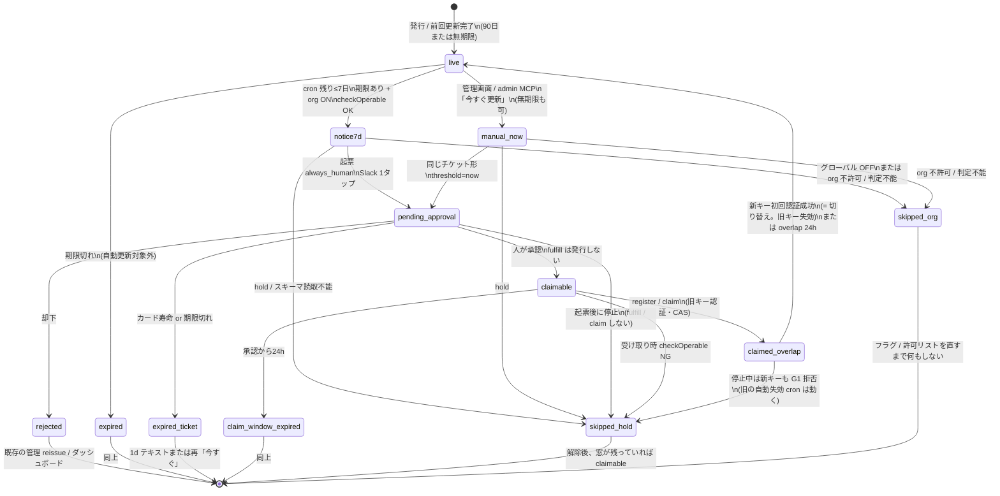
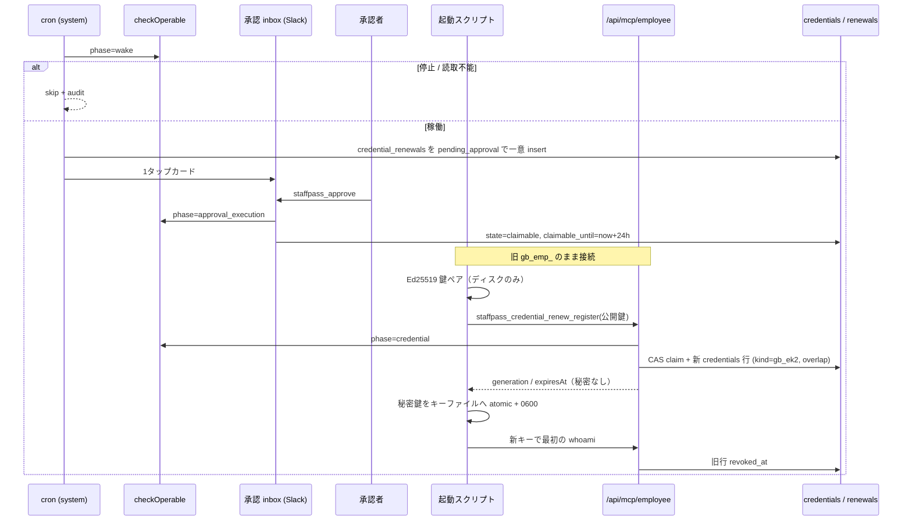

# 社員証（gb_emp_）の自動更新：設計と見積もり（2026-10-16）

- **状態: 設計（レビュー待ち）。** 実装・マージ・デプロイ・env 変更・番号契約はしていない
- 作成: 2026-10-16（設計のみ）
- 対象コード: `pacifico-1106/grokbot-control-plane` main `dc18e8eb`（#384 L-8 マージ時点。`git fetch origin main` で確認）
- 方針の出典: 八坂さん要望（期限 7 日前の Slack 1 タップ、承認後に本人の旧キーで一度だけ受け取り、公開鍵方式を優先、旧キーは初回成功または最長 24 時間で失効、監査、always_human、停止中は不可、フラグ既定 OFF）。**2026-10-16 追記:** 最初に試すのは稲盛（スペースツリー）。フラグはグローバルに加えて org ごと。管理者が「今すぐ更新」できる（7 日前を待たない）。無期限の社員証も対象
- 実装担当の想定: 未定。日数は 1 人の作業日数。レビューと手戻りの余裕は入れていない（音声設計メモ・LINE 設計メモと同じ数え方）
- 実装の開始条件: このメモの未決（§13）のうち、受け取り口（#1）とホスト実行環境（#2）が決まるまで、**全体の V1 実装 PR は始めない。** 稲盛の実地まで（§12-5）は #1 を「実地は gen1 HTTP」で切れば始められる。V0 の起動スクリプト草案は先に書いてよい
- 最初の実地: スペースツリー org `6d134a38-a0ab-4a8e-aba7-3202650ff523`、稲盛の今の無期限社員証 `9a795dfd-…`（プレフィックス。本番のフル UUID はメモに書かない）
- もとにしたコード（動かしてはいない。読んだ）:
  - 期限前通知: `lib/employees/credential-expiry-notice.ts`、migration `20261012100000`
  - 承認付き reissue: `lib/employees/credential-reissue.ts`、migration `20261012200000`
  - 90 日 TTL: `lib/employees/credential-ttl.ts`（`EMPLOYEE_CREDENTIAL_TTL_DAYS = 90`）
  - 表示期限: `lib/employees/credential-expiry.ts`（`CREDENTIAL_EXPIRING_SOON_DAYS = 7`）
  - 認証: `lib/auth/employee-credential.ts`、`lib/mcp-oauth/resource-server.ts`
  - hold: `lib/safety/hold.ts`（`checkOperable`、関所 G1〜G5。フラグ無しで常時）
  - Slack 1 タップ: `lib/notify/slack.ts`（`staffpass_approve` / `staffpass_reject`）、`app/api/webhooks/slack/interactivity/route.ts`
  - always_human / 自己承認拒否: `lib/admin-mcp/queue.ts`、`lib/admin-mcp/self-approval.ts`
  - 監査: `lib/types.ts` `AuditAction`、`lib/audit/types.ts`（`ActorKind` = ai / human / system）
  - OAuth: `lib/mcp-oauth/*`、migration `20261010200000`
  - 積まれている PR: #385〜#389（§2）
- 既存の `docs/agent-credential-guide.md` は発行時の一度きり表示。**本書は期限前の自動更新であり、別物。** 名前を混ぜない
- gen2（公開鍵社員証）は **リポジトリに無い**（`gen2` / `public_key` / `credential_v2` を検索して該当なし）。認証は共有秘密 `gb_emp_` の SHA-256 だけ。無い前提で、優先経路として新設する

---

## 0. 結論

1. **期限の 7 日前に、承認者の Slack へ「社員証を更新しますか」の 1 タップカードを送る。** 既存の期限前通知（`CREDENTIAL_EXPIRY_NOTICE_ENABLED`）の 7d 閾値と、既存の承認付き reissue（`employees.credential.reissue` / `ADMIN_MCP_CREDENTIAL_REISSUE_ENABLED`）を **つなぐ**。新しい承認パイプラインは作らない。カードは今の `sendApprovalNotifications` → `staffpass_approve` を使う。
2. **承認されたら受け取り口が 24 時間開く。** 開ける条件は、本人の今の有効な社員証（旧キー）だけ。OAuth の `sp_at_` では開けない（#388 の社員証口と OAuth 口の分離を守る）。停止中（`checkOperable` が拒否）は開けない。AI は自分で承認できない（`always_human` + cron 起票者は system + admin MCP は既存の自己承認拒否 + resolver が AI なら拒否）。
3. **受け取りは公開鍵方式（gen2）を優先する。** AI 側（起動スクリプト）が Ed25519 鍵ペアを作り、公開鍵だけを MCP ツール `staffpass_credential_renew_register` に渡す。秘密は通信に乗らない。ツール結果にも、チャットにも、シェル出力にも、ログにも秘密を出さない。
4. **共有秘密をツール結果で返す経路は作らない。** モデルが `tools/call` の結果を見るため、`gb_emp_` を MCP ツールの JSON に載せるとチャット漏洩が起きうる。gen1 の互換が要る場合だけ、MCP ツールではない HTTP（起動スクリプト専用）を別フラグで開ける。既定 OFF。
5. **新しいキーで最初に認証が成功したとき、または受け取りから最長 24 時間で、古いキーを失効する。** 今の `rotateCredential`（受け取り瞬間に旧行を全部 `revoked_at`）は自動更新では使わない。重ね置き（overlap）を新設する。
6. **フラグは既定 OFF。グローバルが ON でも、org 許可リストに無いテナントは OFF。** 判定できない・読めないときは OFF（fail-closed）。最初に ON にするのはスペースツリー（`6d134a38-…`）だけ。方式は **env の許可リスト**（§11-1。OAuth パイロットと同じ）。
7. **管理者は「今すぐ更新」で 7 日前を待たずに起票できる。** 場所は管理画面（AI社員ページ）と admin MCP（起票だけ。鍵は返さない）。承認は同じ Slack 1 タップ（always_human）。
8. **無期限の社員証も「今すぐ更新」の対象。** 新しい社員証は 90 日。旧キーは **切り替えた時点**（新キーで最初に認証できたとき）に失効する。24 時間キャップも残す（新キー未使用の安全網）。7d cron は今までどおり期限なしを対象にしない。
9. **ホスト実行環境がキーファイルを書けないコネクタ（Grok.com / Claude / ChatGPT のリモート MCP）では、1 タップ承認までは同じだが、受け取りはできない。** そちらは既存のダッシュボード受け取り、または将来の OAuth に倒す（§8、未決 #2）。**稲盛はキーファイル方式へ移す必要がある**（§10-4、§18）。
10. **見積もり（1 人の作業日数）**
    - **V1（7 日前 + 今すぐ更新 + org 許可リスト + gen2 + 重ね置き + 起動スクリプト + 監査。フラグ OFF）: 約 15 日（±2）**
    - **稲盛の実地テストまで（最短。7d cron と gen2 は後回し）: 約 8.5 日（±1.5）**（§12-5）
    - **gen1 HTTP は最短実地に含める。V1 の本線はあとから gen2**
    - **OAuth 化の実装（将来。このメモでは道筋だけ）: 約 3 日。V1 合計には入れない**

---

## 1. 今のコードの棚卸し（main `dc18e8eb`）

読んだもの。動かしてはいない。

### 1-1. 社員証の寿命と表示

| 部品 | 場所 | 自動更新で使うか |
|---|---|---|
| 既定 TTL 90 日 | `EMPLOYEE_CREDENTIAL_TTL_DAYS`（`lib/employees/credential-ttl.ts`）。発行の欠落/0 も 90。rotate も `now+90`。上限 365 | 新しいキーも 90 日。変えない |
| 期限なしの既存行 | バックフィルしない（コメントどおり。次の rotate で付く） | **7d cron は対象外のまま。** 「今すぐ更新」の対象。新キーは 90 日。稲盛 `9a795dfd-…` がこれ |
| 表示「期限間近」 | `CREDENTIAL_EXPIRING_SOON_DAYS = 7`（`credential-expiry.ts`）。**表示専用。認証は見ない** | 7 日の数字は揃える。認証判断には使わない |
| 認証時の期限 | `resolveEmployeeCredential` が `expires_at < now` なら `expired`（401） | そのまま。切れた旧キーでは受け取り口に入れない |

### 1-2. 期限前通知（`CREDENTIAL_EXPIRY_NOTICE_ENABLED`、既定 OFF）

| 部品 | 今の動き | 自動更新で足りないもの |
|---|---|---|
| 入口 | `app/api/cron/telegram-digest/route.ts` がフラグ ON のとき `runCredentialExpiryNotices` | 同じ cron に乗せる（新しい cron は増やすな） |
| 閾値 | `7d`（残り ≤7 日）と `1d`（残り ≤1 日）。期限切れ・パース不能は対象外 | **7d を 1 タップ承認の起票に使う。** 1d は未承認のときだけテキスト再送 |
| 重複排除 | 表 `credential_expiry_notices` PK `(credential_id, threshold)`。送る前に claim、失敗で release | 自動更新は別表 `credential_renewals`。通知表と renew 表を混ぜない |
| 上限 | org あたり 1 実行 10 件、24h 20 件 | 同じ数字を再利用 |
| 配送 | `sendApprovalInboxText`（**プレーンテキスト。ボタンなし**） | 7d はテキストではなく承認カード |
| 停止 | `employeeStatus !== "active"` は skip。`checkOperable` は **見ていない** | hold を見る（G5。cron は wake に近い） |
| 監査 | `credential.expiry_notice`（id・閾値・件数。本文なし） | 起票は別アクション（§7） |

### 1-3. 承認付き reissue（`ADMIN_MCP_CREDENTIAL_REISSUE_ENABLED`、既定 OFF）

3 段階（`lib/employees/credential-reissue.ts` 先頭コメント）。

| 段 | 関数 | 今の結果 |
|---|---|---|
| 1 起票 | `handleCredentialReissueTool`（管理 MCP） | `always_human` の管理チケット。`reason`: expired / expiring / other。管理エージェントは自分の紐付け社員を狙えない（`cannot_target_self`）。停止・revoked は拒否 |
| 2 承認後 fulfill | `fulfillCredentialReissue` | **発行しない。** ダッシュボードへの案内だけ。監査 `employee.credential.reissue_approved` |
| 3 受け取り | `redeemCredentialReissue`（人が `POST /api/employees/[id]/rotate` + `reissueApprovalId`） | `claim_credential_reissue`（CAS）→ `rotateCredential` → ブラウザに一度だけ表示。**この瞬間に旧キー失効**。窓は承認から 24 時間 |

つなぎ方: **段 1 のチケット形と段 2 の「発行しない」は残す。** 起票者を管理 AI ではなく cron（system）にする。段 3 の受け取り人を「ダッシュボードの人」から「本人の旧キーを持つ起動スクリプト」に分岐する。ダッシュボード受け取り（期限切れ・ブレイクガラス）は残す。

CAS の関数 `claim_credential_reissue` は `adminTool = employees.credential.reissue` 固定。自動更新は **別関数** `claim_credential_renewal` を新しくする（既存関数を拡張して管理受け取りと取り違えない）。

### 1-4. rotate と認証

今の `rotateCredential`（`lib/data/bindings.ts`）:

1. `employee_bindings.credential_generation` を +1
2. `credential_fingerprint` を新ハッシュに置き換え
3. 新しい `credentials` 行を insert（`expires_at = now+90`）
4. 同じ社員の他の生きている行を全部 `revoked_at`

認証（`employee-credential.ts`）は binding の fingerprint を優先し、fingerprint が動いている旧ハッシュは `invalid_credential`。**重ね置きは今はできない。** 自動更新では `issueCredentialOverlap` を新設し、今の rotate はダッシュボード / 管理 reissue のままにする。

### 1-5. hold / `checkOperable`

| 部品 | 場所 | 自動更新 |
|---|---|---|
| 関所 | `checkOperable({phase})`。G1 `credential`、G2 oauth*、G3 `gateway`、G4 `approval_execution`、G5 `wake` / `mcp_events`、送信直前 `pre_send` | 起票 cron は G5 `wake`。受け取りと新キー初回認証は G1。承認カードの fulfill は G4 |
| フラグ | hold 判定にフラグは無い（`EMPLOYEE_HOLD_ENABLED` は UI だけ） | 同じ。止まっていれば更新できない |
| 拒否 | `employee_on_hold` / `org_on_hold` / `hold_state_unavailable`（503 fail-stop） | 読めなければ起票も受け取りもしない |
| 止めたチケット | `assertTicketNotHeld`。hold 中に承認されても実行しない（既定破棄） | 受け取り前に止まっていたら claim しない。解除後も窓が切れていれば再起票 |

### 1-6. always_human と Slack 1 タップ

| 部品 | 今 | 自動更新 |
|---|---|---|
| 管理起票 | `queueAdminTool` が `metadata.always_human: true`、`risk: "high"`、`approvalClass: admin` | cron 起票も同じ印。**「今すぐ更新」だけ** 管理画面と admin MCP から起票する（鍵は返さない） |
| 承認者クラス | `employees.credential.reissue` は standard（オーナーまたは指定管理者）。金銭スコープ / スコープ読取不能はオーナー（`approver-authority/targets.ts`） | `employees.credential.auto_renew` も同じ行に足す |
| 自己承認 | `isSelfApproval` は管理エージェントの requester vs resolver | 起票者を `system` にするのでこの比較には当たらない。**追加: resolver が AI なら常に拒否**（`approvals.proxyResolve` も含む） |
| Slack カード | `staffpass_approve` / `reject` / `revise` / ダッシュボード。カード寿命 7 日 | 文言を「更新しますか」にする。**修正依頼ボタンは出さない**（直す成果物が無い） |
| 期限前通知 | ボタン無しテキスト | 7d はカード。1d はテキスト |

### 1-7. 社員 MCP ツール（今）

`/api/mcp`（`gb_emp_` または `sp_at_`）: `staffpass_whoami` / `invoke` / `get_approval_status` / `health` / `stuck_*` / `decision_request` と、フラグ付きの `config_change_request` / `sensitive_topics` / `staffpass_profile`。

**社員 MCP に社員証を回す・返すツールは無い。** 秘密を AI に返さないのが今の方針（reissue のコメントどおり）。自動更新の gen2 は「公開鍵を受け取る」だけなので、この方針を破らない。

### 1-8. OAuth

- フラグ `MCP_OAUTH_ENABLED`（既定 OFF）。`gb_emp_` は併用可
- グラント寿命上限 `GRANT_MAX_TTL_SEC = 90 * 86400`。社員証の `expires_at` でも切る
- ダッシュボード rotate は任意で `revokeAllEmployeeGrants`（既定は切らない）
- RS は毎回「今の社員証が生きているか」を見る（`getCurrentEmployeeCredential`）

自動更新で OAuth グラントは **切らない**（人がコネクタを再同意しなくてよい）。`credential_id_at_grant` は監査用の当時値のまま。RS は今の行を見る。

### 1-9. 監査

既存: `credential.issued` / `rotated` / `revoked` / `expiry_notice`。reissue の承認は `admin.policy` + metadata event。表示の実行者は `ActorKind` = `ai | human | system`（#374 が main。#386 が解除者メールを直す）。

自動更新の cron は `system`。Slack の承認は `human`。受け取り（起動スクリプト）は `ai`（社員本人）。秘密・フルハッシュは今どおり残さない（12 文字プレフィックスまで）。

### 1-10. 起動スクリプト / mcp-remote

リポジトリに社員証キーファイルの起動スクリプトは無い。`docs/mcp.md` は Cursor / mcp-remote / grok の **再接続** だけ。秘密の形は `mintOneTimeSecret`: `gb_emp_<8hex>_<16hex>`。DB はハッシュのみ。

稲盛の今の起動は env（`${env:STAFFPASS_MCP_TOKEN}` 等）。#385 の「起動直後 key not set」は、この展開が空のまま `Authorization: Bearer` が飛んだことがきっかけ。**キーファイルはまだ使っていない。** 自動で受け取って書き換えるなら、実地の前にキーファイルへ移す（§10-4）。

---

## 2. 積まれている PR #385〜#389

このメモは main から分岐する。実装 PR は **rebase / force-push しない。** 下の PR が先に main へ入ったら、実装ブランチへは merge commit で取り込む。この設計 PR 自体はそれらに積まない。

| PR | head ブランチ | 自動更新との関係 |
|---|---|---|
| **#385** `feat(mcp): /api/mcp 認証失敗の監査と日本語 401、last_used_at 修正` | `cursor/mcp-auth-failure-audit-d5c7`。migration `20261016400000` | **新キー初回成功のフック。** `touch_credential_last_used`（5 分に 1 回）の成功経路で「この行が overlap の新側なら旧を失効」を足せる。認証失敗監査は受け取り口の総当たりを見えるようにする。日本語 401 は社員 id を出さない（守る） |
| **#386** `fix(audit): 緊急停止の解除者メールと started_by による人/AI 判定` | `cursor/hold-audit-actor-email-c273`。migration `20261016300000` | 自動更新の監査も `actor_email` を AI が渡せないようにする。cron は system。解除中の社員を更新しない判定は hold 本体（#386 は表示） |
| **#387** `feat(operator-notices): PR-C /admin/notices` | `cursor/operator-notices-admin-b2da`（#368 の `20261016200000` の上） | 直接は使わない。運営お知らせと社員証更新を混ぜない |
| **#388** `fix(mcp): 空 Bearer で OAuth DCR に落ちない社員証口` | `cursor/mcp-badge-oauth-dcr-7954`。フラグ `MCP_EMPLOYEE_BADGE_MCP_ENABLED` | **受け取り口は `/api/mcp/employee` に置く（フラグ ON 時）。** `sp_at_` 拒否。`staffpass_profile` を出さない。challenge / resource_metadata を出さない。起動スクリプトはこちらを向ける |
| **#389** `feat(mcp): whoami に社員証期限とテナント名` | `cursor/whoami-credential-info-30af`（#388 の上）。フラグ `WHOAMI_CREDENTIAL_INFO_ENABLED` | 起動スクリプトが期限を知る入口。ON のとき `expiringSoon` と `nextStepJa` が「管理者に再発行を依頼」になっている。自動更新 ON かつ claimable なら **「起動スクリプトが公開鍵を登録する」** に差し替える。OFF のバイト同一性は壊さない |

migration 番号の空き（衝突しないこと）:

| 番号 | 状態 |
|---|---|
| `20261016100000` | main（ai_peer_wake_guard） |
| `20261016200000` | #368 / #370（operator_notices） |
| `20261016300000` | #386（hold_release_actor_email） |
| `20261016400000` | #385（mcp_auth_failures） |
| **`20261017xxxxxx` 以降** | **この設計の実装用。未使用** |

---

## 3. 対象と対象外

### 3-1. 対象（V1）

- 期限が付いている **稼働中** の社員証。閾値 7d（cron）
- **無期限の稼働中の社員証**（「今すぐ更新」だけ。7d cron は見ない）
- Slack を既定承認 inbox にしているテナント（今の通知と同じ解決）
- 起動スクリプトを置ける実行環境（Cursor ローカル、mcp-remote、自前ホスト）
- 最初の実地: スペースツリー + 稲盛
- gen2（Ed25519）は V1 本線。稲盛の最短実地は gen1 HTTP（§12-5）
- 旧 `gb_emp_` は受け取りまでの通行証

### 3-2. 対象外

- すでに期限切れ（旧キーで入れない。既存の管理 reissue + ダッシュボード）
- 管理証 `gb_adm_`
- ホスト側でキーファイルを書けないコネクタへの秘密配送（モデル経由は禁止）
- スペースツリー以外の org を最初の実地で ON にすること
- 本番のグローバル ON（許可リスト無し）、デプロイ、env 変更（このメモと実装 PR ではやらない）
- OAuth の実装そのもの（§8 は道筋）
- 期限なし行への `expires_at` バックフィル（更新した行だけ 90 日が付く）

---

## 4. 状態遷移

受け取り前の旧キーは、承認待ちのあいだも有効（今の reissue と同じ。待ち時間に止まらない）。





---

## 5. API

グローバル `CREDENTIAL_AUTO_RENEW_ENABLED` が OFF、または呼び出し元 org が許可リストに無い / 判定不能なら、以下は未登録・404 / `feature_disabled`。新しい表に触れない。判定は §11-1。

### 5-1. 社員 MCP ツール（モデルから呼んでよい）

社員証口（`/api/mcp/employee`、#388 ON 時。OFF なら `/api/mcp` でも同じツールを出すが `sp_at_` は拒否）。**秘密を返さない。**

#### `staffpass_credential_renew_status`

参照専用。承認は要らない。

入力:

```json
{}
```

`additionalProperties: false`。引数なし。

出力（本人の分だけ）:

```json
{
  "ok": true,
  "state": "none | expiring | pending_approval | claimable | claimed_overlap | held | expired",
  "expiresAt": "2026-12-01T00:00:00.000Z",
  "claimUntil": null,
  "overlapUntil": null,
  "mode": "gen2",
  "generation": 3,
  "nextStepJa": "社員証の期限が近づいています。承認者が Slack で更新を承認すると、起動スクリプトが公開鍵を登録できます。"
}
```

返さないもの: 秘密、prefix、hash、公開鍵、他社員、他 org、承認者の個人情報。`approvalId` は出してもよいが、起動スクリプトは **今の Bearer の社員に開いている窓だけ** を見る（id をクライアントから指定させない。未決 #4）。

`state=claimable` の `nextStepJa`（#389 差し替え）: 「承認済みです。起動スクリプトが公開鍵を登録してください。チャットに鍵を貼らないでください。」

#### `staffpass_credential_renew_register`

gen2 の受け取り口。always_human の承認 **済み** が前提。この呼び出し自体は再承認しない（窓が承認の結果）。

入力:

```json
{
  "alg": "Ed25519",
  "publicKey": "<base64url 32 bytes>"
}
```

| フィールド | 必須 | 制約 |
|---|---|---|
| `alg` | はい | `"Ed25519"` のみ（V1） |
| `publicKey` | はい | base64url、デコードして 32 バイト。圧縮なし。SPKI は受け取らない（実装が分かれないようにする） |

出力（成功）:

```json
{
  "ok": true,
  "generation": 4,
  "expiresAt": "2027-01-14T00:00:00.000Z",
  "overlapUntil": "2026-10-17T09:00:00.000Z",
  "nextStepJa": "公開鍵を登録しました。起動スクリプトがキーファイルを書き換えたあと、新しい鍵で再接続してください。古い社員証は初回成功または24時間で失効します。"
}
```

失敗 `code`（`isError: true`、秘密なし）:

| code | とき |
|---|---|
| `feature_disabled` | フラグ OFF |
| `oauth_refused` | `sp_at_` |
| `not_claimable` | 未承認 / 対象外 |
| `already_claimed` | CAS 負け |
| `window_expired` | 承認から 24 時間超過 |
| `held` | `employee_on_hold` / `org_on_hold` |
| `hold_state_unavailable` | 503 |
| `invalid_key` | 形が違う。値はエコーしない |
| `employee_terminated` | suspended |
| `revoked` | binding revoked |

### 5-2. 社員 MCP に **置かない** もの

- 新しい `gb_emp_` を返すツール
- `staffpass_invoke` 経由の更新（モデルが fulfillment を見る）
- 管理 MCP から **鍵を返す** こと（起票だけなら可。§5-4）

### 5-3. HTTP（モデルから見えない。起動スクリプト専用）

| 方法 | 経路 | 役割 |
|---|---|---|
| （推奨） | なし | gen2 は上の MCP ツールだけ。スクリプトが鍵ペアを作り、ツールを呼び、秘密鍵をファイルへ書く |
| （任意・別フラグ） | `POST /api/mcp/employee/credential/claim` | gen1。旧 `gb_emp_` のみ。本文 JSON に `credential` を一度だけ。`Cache-Control: no-store`。MCP `tools/list` に出さない。フラグ `CREDENTIAL_AUTO_RENEW_GEN1_HTTP_ENABLED` 既定 OFF |

gen1 を開けるなら、スクリプトは応答を **ファイルへ直接** 書き、標準出力に出さない（§10）。V1 本線の推奨は **開けない**（gen2）。**稲盛の最短実地だけ** このフラグをスペースツリーに限り一時 ON にする（§12-5、§18）。

### 5-4. 「今すぐ更新」— 管理画面と admin MCP（起票だけ）

7 日前を待たない入口。**発行しない。鍵を返さない。** 承認は Slack 1 タップ。無期限も可。

#### 管理画面

場所: `/app/employees/[id]` の接続パネル（今の「社員証を再発行」の隣）。`BindingPanel`。権限は rotate と同じ（`requireCredentialAdmin` + `web.employeeRotate` / 承認者クラス）。

- ボタン文言: **今すぐ更新**
- 押すと `POST /api/employees/[id]/renew`（新設。rotate とは別）。本文は `{ reason: "now" }` だけ
- 成功: `{ ok: true, approvalId, nextStepJa: "承認者の Slack に「更新しますか」を送りました。鍵はこの画面には出ません。" }`
- 失敗: `feature_disabled`（グローバル OFF / org 不許可 / 判定不能）、`held`、`employee_terminated`、`already_pending`
- **秘密は返さない。** 今の rotate（ブラウザに一度だけ表示）と混ぜない

無期限の表示: 期限欄が「無期限」のとき、ボタンの下に「更新すると新しい社員証は 90 日になります」と書く。

#### admin MCP `employees.credential.auto_renew`

フラグ + org 許可が両方通ったときだけ list に出す。`employees.credential.reissue`（ダッシュボード受け取り）とは別ツール。

入力:

```json
{
  "employeeId": "<this org only>",
  "reason": "now",
  "jobId": "<optional>",
  "approvalId": "<re-read only>"
}
```

| フィールド | 必須 | 制約 |
|---|---|---|
| `employeeId` | はい | 管理証の org だけ。他 org は `employee_not_found` |
| `reason` | いいえ | V1 は `"now"` のみ（省略時 `now`） |
| `jobId` / `approvalId` | いいえ | 今の管理ツールと同じ再読取 |

出力（起票）: 今の `queueAdminTool` と同じ `needs_approval`（`always_human: true`、`approvalId`、`statusToken`、`pollHint`）。`summary` は「AI社員 … の社員証を今すぐ更新します（無期限→90日 / 期限あり→今+90日）。承認しても鍵は AI に返しません。」

再読取（`approvalId`）: ダッシュボードポインタと `claimable` / `claimed` の状態だけ。秘密なし。

拒否: `cannot_target_self`（管理エージェントが自分の紐付け）、`held`、`feature_disabled`、`employee_terminated`、`revoked`。

#### 既存のまま

| 入口 | 役割 |
|---|---|
| `employees.credential.reissue` | 期限切れ・ブレイクガラス。人がダッシュボードで受け取る。旧キー即時失効 |
| `POST /api/employees/[id]/rotate` | 人が明示 rotate。自動更新の claimable チケットはここでは受け取れない |

### 5-5. cron

今の `telegram-digest` に足す（グローバル ON かつ **その org が許可リストにあるときだけ** import / 処理）。

1. `listExpiring`（今の 7d 地平）。**無期限は載せない**
2. 社員が active、org 一致、`isCredentialAutoRenewOnForOrg(orgId)`、`checkOperable({phase:"wake"})`
3. `credential_renewals` に `(old_credential_id, threshold='7d')` を一意 insert（既にあれば skip）。`threshold='now'` の進行中があれば 7d は起票しない（1 窓）
4. `createApproval`（`always_human`、tool = `employees.credential.auto_renew`、requester = system）
5. `sendApprovalNotifications`（Slack 1 タップ）
6. 失敗したら renew 行を消すか `held_blocked` にして次回再送（通知の release と同じ）
7. 1d かつ ticket が未承認: 今のテキスト通知（`CREDENTIAL_EXPIRY_NOTICE_ENABLED` が ON のときだけ）
8. 別ループ: `overlap_until < now` かつ旧行が生きている → 旧を失効

「今すぐ更新」は cron を通らない。同じ `createApproval` + 同じカード。

---

## 6. DB と migration

実装 PR で足す。**この設計 PR には SQL を置かない。** 番号は `20261017xxxxxx` 以降。#368 / #385 / #386 とぶつからない。`scripts/test-db-all-migrations.py` と `scripts/test-db-local.py` に載せる（他 PR と同じ）。ROLLBACK を `supabase/verification/` に置く。RLS ON、policy なし、`anon` / `authenticated` / `public` は REVOKE、`service_role` だけ。

### 6-1. `20261017100000_credential_auto_renew.sql`（R1）

表 `credential_renewals`:

| 列 | 型 | 意味 |
|---|---|---|
| `id` | uuid PK | |
| `org_id` | uuid NOT NULL → orgs | |
| `employee_id` | uuid NOT NULL → employees | |
| `old_credential_id` | uuid NOT NULL → credentials | 起票時点の今の行 |
| `new_credential_id` | uuid NULL → credentials | 受け取り後 |
| `approval_id` | uuid NOT NULL → approval_requests | |
| `threshold` | text CHECK (`7d` / `now`) | cron は `7d`。管理画面 / admin MCP は `now` |
| `state` | text | `pending_approval` / `claimable` / `claimed` / `old_revoked` / `rejected` / `expired` / `held_blocked` |
| `mode` | text | `gen2` / `gen1_http` |
| `claimable_until` | timestamptz NULL | 承認時刻 + 24h |
| `overlap_until` | timestamptz NULL | 受け取り時刻 + 24h |
| `claimed_at` | timestamptz NULL | |
| `old_revoked_at` | timestamptz NULL | |
| `created_at` | timestamptz NOT NULL default now() | |

制約:

- `UNIQUE (old_credential_id, threshold)` — 同じ社員証の 7d と now はそれぞれ一度だけ。進行中はアプリで社員あたり 1 窓（§13 #6）
- trigger `credential_renewals_same_org`: credentials / employees / approval の org が一致しない insert/update を例外（`credential_expiry_notices_same_org` と同じ形）
- 本文・秘密・公開鍵は置かない

関数（`security invoker`、EXECUTE は service_role のみ）:

- `claim_credential_renewal(p_id, p_org, p_employee, p_token, p_at) returns boolean`  
  条件付き UPDATE 1 本。`state='claimable'` かつ `claimable_until >= now` かつ `claimed_at IS NULL` のときだけ `claimed` にする。READ COMMITTED で同時は 1 勝（今の `claim_credential_reissue` と同じ）
- `release_credential_renewal(p_id, p_org, p_token) returns boolean`  
  自分の token のときだけ戻す（rotate 失敗の補償。他人の claim は外せない）
- `revoke_overlapped_old_credential(p_renewal, p_org, p_old, p_new) returns boolean`  
  旧行に `revoked_at` を条件付きで付ける（すでに revoked なら true）

### 6-2. `20261017200000_credential_gen2.sql`（R4）

`credentials` に足すだけ（既存行は `kind='gb_emp'`）:

| 列 | 型 | 意味 |
|---|---|---|
| `kind` | text NOT NULL default `gb_emp` CHECK (`gb_emp` / `gb_ek2`) | |
| `public_key` | text NULL | gen2 の raw 32 バイトを base64url。`gb_emp` は NULL |
| `public_key_alg` | text NULL | `Ed25519` |
| `overlap_until` | timestamptz NULL | 新側に付ける。切れたら旧を失効してよい印 |
| `replaces_credential_id` | uuid NULL | 旧行 |

CHECK: `kind='gb_ek2'` なら `public_key` と `public_key_alg` が NOT NULL。`kind='gb_emp'` なら両方 NULL。

`secret_hash`:

- gen1: 今どおり生秘密の SHA-256
- gen2: 公開鍵バイトの SHA-256（照合の安定 id。署名検証は `public_key`）

表 `credential_gen2_jti`（JWT の `jti` 再利用防止）:

| 列 | 意味 |
|---|---|
| `jti_hash` | text PK（jti の SHA-256） |
| `org_id` / `employee_id` | テナント分離 |
| `seen_at` / `expires_at` | 期限後に purge |

### 6-3. 認証の読み方（アプリ。migration だけでは足りない）

重ね置き中（renewal.state = `claimed`、`old_revoked_at` が空、`overlap_until >= now`）:

- 旧 `gb_emp_` も新 `gb_ek2_` も、それぞれの行が `revoked_at IS NULL` かつ期限前なら通す
- `employee_bindings.credential_fingerprint` は **旧のまま** 残す（今の「fingerprint が動いたら旧は invalid」を壊さない）
- 新キー初回成功、または cron が `overlap_until` 切れを見たとき、旧を失効し fingerprint を新へ、generation は受け取り時に既に +1 済み

`rotateCredential`（ダッシュボード）は今のまま即時失効。自動更新専用関数と混ぜない。

---

## 7. 監査

秘密・フルハッシュ・公開鍵の生値・JTI 生値は残さない。

| action（案） | actor | いつ | metadata に入れてよいもの |
|---|---|---|---|
| `credential.renew_proposed` | system または human | 7d cron / 今すぐ更新 | approvalId、employeeId、oldCredentialId、threshold（`7d` / `now`）、source=`cron` / `web` / `admin_mcp` |
| `credential.renew_approved` | human | Slack 承認 | approvalId、approver は今の approval 結合（#374 / #386） |
| `credential.renew_rejected` | human | 却下 | 同上 |
| `credential.renew_claimed` | ai | register / claim 成功 | generation、newCredentialId、mode、hash 12 文字、overlapUntil。秘密なし |
| `credential.renew_claim_denied` | ai または unknown | 拒否 | code だけ（存在オラクルを揃える。unknown と revoked は同じ文、#385） |
| `credential.renew_old_revoked` | system または ai | 初回成功 or 24h cron | old/new id、reason=`first_auth` / `overlap_timeout` |
| `credential.renew_skipped_hold` | system | cron / claim が hold | holdId、phase、code |
| 既存 `credential.expiry_notice` | system | 1d テキスト | 今どおり |

`/app/audit` の日本語ラベルを `lib/audit/labels-ja.ts` に足す（#373 の投影。生 JSON は出さない）。

---

## 8. 将来の OAuth 化

V1 では実装しない。道筋だけ。

```text
今:    共有秘密 gb_emp_ （90日、人がコネクタに貼る）
V1:    7日前 1タップ → gen2 公開鍵（秘密はホストのキーファイル）
       ホストできないコネクタはダッシュボード受け取りのまま
次:    リモート MCP は OAuth（今の MCP_OAUTH_ENABLED）
       社員証の 90 日切れで RS が切るので、更新は「再同意」か
       「private_key_jwt で refresh を回す」
その先: gb_emp_ を発行しない。初回だけ同意画面。以降は refresh 回転
```

守り:

- 受け取り口に `sp_at_` を使わせない（盗んだ OAuth トークンで新しい社員証を発行できない）
- 自動更新でグラントを一括 revoke しない（#216 の任意チェックとは別。人が再同意しなくてよい）
- OAuth クライアントの長期秘密は Staffpass のキーファイルに置かない（AS が refresh を持つ）
- `staffpass_profile` は OAuth 口だけ（#388）。社員証口から誘導しない

実装を始める条件: V1 のフラグがパイロットで ON になり、ホストできないコネクタの割合が分かってから。見積もり 3 日は V1 に含めない。

---

## 9. 脅威モデル

Fail-closed が既定。可用性のために緩める箇所は明示する。

### 9-1. 旧キー漏洩で更新を乗っ取られないか

サーバーから見ると、旧キーの所持者 = その社員。承認後 24 時間の窓で、漏洩した旧キーの所持者が先に `register` すると、 攻撃者の公開鍵が新しい社員証になる。

抑止:

- **承認前は窓が無い。** 攻撃者は自分で承認できない（always_human、起票者 system、resolver が AI なら拒否）
- 窓は 24 時間、単勝 CAS
- 受け取り成功を承認者へ Slack 事後通知（秘密なし。generation だけ）
- `sp_at_` では受け取れない
- 任意: 直近の `last_used_at` / W1 `recordMcpClientSeen` と違うクライアントなら拒否（未決 #5。V1 は入れない）

限界: 承認後に旧キーが既に漏れていれば、先に登録した側が勝つ。これは「社員証 = 通行証」の今のモデルと同じ。gen2 は **通信路上の新秘密** を消すが、旧キー所持者の競合は消さない。

### 9-2. 再送（リプレイ）

| 対象 | 対策 |
|---|---|
| 承認カード | 今の delivery 照合 + カード 7 日 + `resolveApproval` の状態機械 |
| register | CAS。2 回目は `already_claimed` |
| gen2 JWT | `jti` をハッシュで記録。`exp` 最大 60 秒。切れた jti は purge |
| 旧キー（失効後） | `revoked_at` / fingerprint 移動で 401 |

### 9-3. 二重受け取り

今の `claim_credential_reissue` と同じ条件付き UPDATE。勝った 1 本だけが新行を insert。負けは mint / 公開鍵保存をしない。insert が失敗したら `release_*` で自分の token だけ戻す。

ダッシュボード reissue と自動更新が同時にあるとき: **社員あたり受け取り中の窓は 1 つ。** 片方を claim したらもう片方は `already_claimed`（未決 #6 の推奨）。

### 9-4. 受け取り口の競合

- 2 プロセスが同じ旧キー: CAS で 1 勝
- gen2 と gen1 HTTP を両方開けない（mode は renewal 行で固定。V1 は `gen2`）
- ツールと HTTP が別社員を指定できない（orgId / employeeId 引数なし。Bearer の本人）

### 9-5. 失効の失敗

新キーは通したが旧の `revoked_at` が失敗: 重ね置きが続く（可用性優先）。cron が再試行。`overlap_until` を過ぎても旧が生きていたら監査 + 運営アラート。**自動 hold はしない**（誤って全員を止める方が高い）。失敗を握りつぶして成功扱いにしない。

### 9-6. テナント分離

- すべての query に `org_id`
- same_org trigger
- Bearer の org 以外の renewal / credential を id 指定で取れない
- whoami / status は本人だけ（#389 と同じ。他テナントの `getOrgName` を呼ばない）
- 通知本文に他 org の id を混ぜない（今の notice と同じ）

### 9-7. Fail-closed

| 状況 | 動き |
|---|---|
| フラグ OFF / org 不許可 / 許可リスト読取不能 | ツール非表示、HTTP 404、cron はその org を触らない、新表に触れない |
| 新表が未適用 | フラグ ON でも起票・受け取りを拒否。旧認証は今どおり |
| hold 読取不能 | 503。起票しない、受け取らない |
| inbox 無し | 起票しない（黙って更新しない） |
| 承認前 / 窓切れ | 受け取らない |
| 公開鍵の形が不正 | `invalid_key`。値をログに出さない |
| 社員 suspended / binding revoked | 今の reissue と同じ拒否 |

### 9-8. 秘密の露出面

- MCP ツール結果に秘密を載せない（モデル = チャット）
- 監査・Slack・whoami に秘密 / 公開鍵 / prefix を載せない
- 起動スクリプトは echo しない、`set +x`、応答をパイプでファイルへ
- gen1 HTTP を開ける場合も `tools/list` に出さない

---

## 10. 起動スクリプト（参照実装の概要）

実装 PR R5 で `scripts/staffpass-mcp-boot.sh`（または `.ts`）を置く。この設計 PR には実体を置かない。

目的: mcp-remote（または Cursor の MCP stdio）を、空キーで起動しない。更新時は公開鍵登録とキーファイルの原子置換だけをやる。

### 10-1. 入力

| 名前 | 意味 |
|---|---|
| `STAFFPASS_MCP_URL` | 既定 `https://staffpass.sealith.com/api/mcp/employee`（#388）。未設定で共有口にしない |
| `STAFFPASS_CREDENTIAL_FILE` | キーファイルのパス。権限 0600 |
| `STAFFPASS_MCP_TOKEN` | 任意。ファイルが無いときの初期（env）。**空文字は未設定扱い** |
| `STAFFPASS_AUTO_RENEW` | スクリプト側の許可。サーバーフラグとは別。ホストが書いたくないときは 0 |

### 10-2. 動き

1. `set -euo pipefail`、`set +x`（`BASH_XTRACEFD` も閉じる）
2. ファイルも env も空 → **起動しない。** メッセージは「社員証が空です」だけ。値を出さない。exit 2
3. 一時ファイルにだけ読み、`chmod 600`
4. （任意）`staffpass_whoami` / `staffpass_credential_renew_status`。応答をログに生で残さない
5. `state=claimable` かつ `STAFFPASS_AUTO_RENEW=1`:
   1. `openssl` または `node crypto` で Ed25519 を **一時ディレクトリ** に生成
   2. 公開鍵だけを register に渡す
   3. 失敗: 旧キーファイルを触らない。旧のまま起動してよいかは status 次第（未決 #7。推奨は旧のまま起動し、次回再試行）
   4. 成功: 秘密鍵（または新しい `gb_emp_`）を `FILE.tmp.$RANDOM` に書き、`chmod 600`、`mv` で原子置換、一時鍵を消す
6. 空ファイルになっていたら起動しない（途中失敗）
7. `exec` で mcp-remote。ヘッダはファイルから。`echo` しない

mcp-remote の形（概要）:

```bash
# 値はファイル経由。ここにはリテラルを書かない
npx --yes mcp-remote "$STAFFPASS_MCP_URL" \
  --header "Authorization: Bearer $(tr -d '\n' < "$STAFFPASS_CREDENTIAL_FILE")"
```

gen2 の JWT（60 秒）は、このスクリプトの前段で毎回署名するか、小さなローカルプロキシを同じ R5 で足す。静的 Bearer しか持てないクライアントは gen2 を使えない（未決 #2）。

### 10-3. 空キーで止めないといけない理由

#385 / #388 の現場: env 未展開で `Authorization: Bearer` が空き、OAuth DCR に落ちた。サーバー側の防御（#388）に加え、クライアントは空でプロセスを上げない。

### 10-4. 稲盛の起動をキーファイルへ移すか

**移す必要がある。** 今は env（`${env:STAFFPASS_MCP_TOKEN}`）。起動スクリプトが新しいキーを原子置換できる場所が無い。コネクタ UI の env は AI が書き換えられない。

実地の前に人が一度だけやる（新しい秘密は作らない）:

1. 今の有効な `gb_emp_` をホストのキーファイルへ書く（`chmod 600`）。値はチャットに出さない
2. mcp 設定を `STAFFPASS_CREDENTIAL_FILE` + `staffpass-mcp-boot.sh` に切り替える
3. env のトークン参照を外す（空 Bearer の再発を止める）
4. 旧キーのまま `staffpass_whoami` が通ることを確認してから「今すぐ更新」する

移さない場合: 承認まではできるが、受け取りは人がダッシュボードで貼る（自動更新の実地にならない）。Grok.com コネクタのままなら §3-2 の対象外。

稲盛が Cursor / mcp-remote / 自前ホストならキーファイルへ移せる。#385 の「key not set」は env 展開の失敗なので、ファイル方式に移すこと自体が再発防止になる。

---

## 11. フラグ

`parseFlag` は今どおり。未設定 = OFF。

| 環境変数 | 既定 | 役割 |
|---|---|---|
| `CREDENTIAL_AUTO_RENEW_ENABLED` | OFF | グローバル。OFF なら全 org で新表に触れない |
| `CREDENTIAL_AUTO_RENEW_ORG_ALLOWLIST` | 空 | カンマ区切り org UUID。グローバル ON のとき、ここに無い org は OFF |
| `CREDENTIAL_AUTO_RENEW_ORG_ALLOWLIST_REQUIRED` | **true**（未設定も true） | リストが空 / 欠け / パース不能なら **全 org OFF**。明示的な `0` / `false` だけが「リスト空 = 全 org ON」 |
| `CREDENTIAL_AUTO_RENEW_GEN1_HTTP_ENABLED` | OFF | gen1 HTTP。稲盛の最短実地だけ一時 ON |
| 既存 `CREDENTIAL_EXPIRY_NOTICE_ENABLED` | OFF | 1d テキストと、自動更新 OFF のときの 7d テキスト。自動更新 ON の 7d はカードなので **二重にテキストを送らない** |
| 既存 `ADMIN_MCP_CREDENTIAL_REISSUE_ENABLED` | OFF | ダッシュボード受け取り。自動更新では立てなくてよい |
| 既存 / PR の MCP フラグ | それぞれの既定 | 自動更新で勝手に立てない |

判定関数（案）`isCredentialAutoRenewOnForOrg(orgId)`:

1. `orgId` が空 / 非 UUID → **OFF**
2. グローバルが OFF → **OFF**（新表に触れない）
3. 許可リストを読む。env が読めない・壊れている → **OFF**
4. `REQUIRED` が true（既定）かつリストが空 → **OFF**
5. リストが空でなく、`orgId` が無い → **OFF**
6. それ以外 → ON

他テナントの id をログに並べない。拒否は `feature_disabled` だけ（許可リストの中身を返さない）。

最初に入れる値（本番作業。この PR ではやらない）:

```text
CREDENTIAL_AUTO_RENEW_ENABLED=true
CREDENTIAL_AUTO_RENEW_ORG_ALLOWLIST=6d134a38-a0ab-4a8e-aba7-3202650ff523
```

`REQUIRED` は立てない（既定 true）。TOKYO307 や他 org は入れない。

### 11-1. 方式の候補と推奨

| 方式 | 利点 | 欠点 |
|---|---|---|
| **A. env 許可リスト**（`MCP_OAUTH_ORG_ALLOWLIST` と同じ。`lib/mcp-oauth/config.ts` の `isOrgAllowedForOAuth`） | 実装が小さい。DB 障害で「誤って ON」にならない。最初の 1 org は UUID を 1 行足すだけ。空リスト fail-closed の前例がある | テナントが増えるたびに env を変える。変更はデプロイ / 再起動 |
| B. DB の org 設定（`orgs` の列または `org_settings`） | 画面から ON/OFF できる。再起動が要らない | 列の migration、管理 UI、**読取不能を OFF にする**経路が要る。読取失敗を「無い」と取り違えると他 org が開く |
| C. 両方（env AND DB） | 二重の栓 | 最短実地には重い |

**推奨: A（env 許可リスト）。** 理由:

- 最初に ON にするのはスペースツリー 1 件だけ（八坂さん）。env 1 行で足りる
- 読めない / 空 / 壊れている → OFF。OAuth パイロットと同じ fail-closed
- 「グローバル ON + リスト空 = 全社 ON」を既定で禁止する（`REQUIRED` 既定 true）
- DB 方式は、テナントが自分で開けてよい段階（V1 のあと）に足す。足すときは **env が空なら DB を見ない**（env 空 = 全 OFF のまま）

コードにスペースツリー UUID をハードコードしない（`no-hardcoded-tenant-values`）。入れる場所は env だけ。

---

## 12. PR 分割と見積もり

フラグ OFF で入れる。migration は足すだけ。ROLLBACK 付き。**rebase / force-push しない。** 依存 PR が main に入ったら merge commit。

### 12-1. この PR（設計）

| PR | 内容 | 日数 |
|---|---|---|
| R0 | 本メモ（実装なし） | 0.5（本作業） |

### 12-2. V1（約 15 日）

| PR | 内容 | 日数 | 前提 |
|---|---|---|---|
| R1 | migration `20261017100000`（threshold に `now`）、フラグ、**org 許可リスト（env、fail-closed）**、型、RLS / 関数の DB テスト。挙動は変えない | 1.0 | 未決 #3 が新ツール名で確定 |
| R-now | 「今すぐ更新」: `POST /api/employees/[id]/renew`、`BindingPanel` ボタン、admin MCP `employees.credential.auto_renew`（起票だけ）、Slack 1 タップ、無期限可、hold / org 不許可。単体 + interactivity | 1.5 | R1 |
| R2 | 7d cron 起票、1d テキストは二重にしない、進行中の `now` があれば 7d しない | 2.0 | R1、R-now のチケット形 |
| R3 | `issueCredentialOverlap`、認証が旧+新を通す、**初回成功 = 切り替えで旧失効**、24h cron、今の rotate は不変。#385 の `last_used_at` にフック | 2.5 | R1、できれば #385 |
| R4 | gen2 列（`20261017200000`）、`staffpass_credential_renew_status` / `_register`、JWT、`sp_at_` 拒否、#388 社員証口 | 3.5 | R-now、R3、できれば #388 |
| R5 | `scripts/staffpass-mcp-boot.sh`、空キーで停止、atomic 0600、register / claim、mcp-remote。秘密を出さないテスト | 1.5 | R4 または R8 |
| R6 | 監査と日本語投影、#389 の `nextStepJa` 差し替え（フラグ OFF はバイト同一）、claim 事後 Slack | 1.5 | R-now、R4、できれば #389 |
| R7 | runbook、本番作業、フラグ OFF / 他 org OFF 回帰 | 0.5 | R5、R6 |
| | **V1 小計** | **14.0 + R0 0.5** | |

**V1 約 15 日（±2）。** 未決の待ちは含まない。R8（gen1 HTTP）を V1 本線に入れない。稲盛の最短実地（§12-5）では R8 を先に使う。

### 12-3. 続き（V1 合計に入れない。最短実地では R8 だけ先に使う）

| PR | 内容 | 日数 | 前提 |
|---|---|---|---|
| R8 | gen1 HTTP claim（別フラグ OFF） | 1.5 | 稲盛の最短実地。V1 本線のあとは OFF のまま残してよい |
| R9 | OAuth 再同意 / private_key_jwt（§8） | 3.0 | V1 パイロットのあと |
| R10 | クライアント指紋の縛り（未決 #5） | 1.0 | 乗っ取り懸念が残ったとき |
| R11 | org フラグを DB 設定にする（§11-1 の B）。env 空なら見ない | 1.5 | テナントが自分で開ける段階 |

### 12-5. 稲盛の実地テストまで（最短）

7d cron（R2）と gen2（R4）を後回しにする。無期限 → 90 日の「今すぐ更新」だけをスペースツリーで 1 本通す。

| 順 | PR | 日数 | なぜ要るか |
|---|---|---|---|
| 1 | R1（スキーマ + org 許可リスト） | 1.0 | 他 org を開けない栓 |
| 2 | R-now（今すぐ更新 + Slack 1 タップ） | 1.5 | 7 日を待たない入口 |
| 3 | R3（重ね置き + 初回成功で旧失効） | 2.5 | 稲盛を止めずに切り替える |
| 4 | R8（gen1 HTTP claim） | 1.5 | 今の `gb_emp_` のまま受け取れる。JWT サイドカーが要らない |
| 5 | R5（起動スクリプト + キーファイル） | 1.5 | 受け取ったキーを書く場所 |
| 6 | 監査の最小（R6 から proposed / approved / claimed / old_revoked だけ） | 0.5 | 実地の成功条件 |
| | **最短小計** | **8.5** | |

**約 8.5 日（±1.5）。** レビュー待ちと、稲盛ホストへのキーファイル移設（人の作業。§18）は含まない。

後回し（実地のあと、V1 残り）:

- R2 7d cron（+2.0）
- R4 gen2（+3.5）— 実地が通ってから本線を公開鍵に戻す
- R6 の残り / R7（+1.5）

実地で gen2 までやるなら最短は **約 10.5 日（±2）**（R8 の代わりに R4）。推奨しない。稲盛は今 static Bearer なので、キーファイル + 同じ `gb_emp_` 形の方が段差が小さい。

順番: R1 → R-now → R3 → R8 → R5。並行できるのは R-now と R3 のテスト準備だけ。マージは merge commit。

### 12-4. 既存 PR との順番

- この設計は main から独立
- 実装 R3 は #385 の `last_used_at` があるとフックが短い。無ければ同等の touch を R3 に書く（二重実装は #385 マージ後に merge して片側を消す）
- 受け取り URL は #388 の `/api/mcp/employee` が望ましい。未マージなら共有口 + `sp_at_` 拒否だけ先に入れる
- #389 の whoami 差し替えは R6。未マージなら status ツールだけでも起動スクリプトは動く
- #386 / #387 はブロッカーではない

---

## 13. 未決と推奨

| # | 項目 | 推奨 | V1 を止めないか |
|---|---|---|---|
| 1 | 受け取りを gen2 だけにするか、gen1 HTTP も最初から開けるか | **V1 本線は gen2。稲盛の最短実地だけ gen1 HTTP（R8、スペースツリー限定）。** 秘密はツール結果に載せない | 実地を先にするなら #1 をこの推奨で切ってよい。全体 V1 はまだ #2 待ち |
| 2 | Grok.com / Claude / ChatGPT はキーファイルを書けない | **1 タップまでは共通。受け取りは対象外。** 人が貼るか、OAuth（R9）。**稲盛はキーファイルへ移す**（§10-4） | 稲盛のホストがファイルを書けるなら実地は進めてよい |
| 3 | 起票ツール名を既存 `employees.credential.reissue` にするか | **新名 `employees.credential.auto_renew`。** チケットと CAS をダッシュボード受け取りと分け、fulfill 文言を取り違えない。つなぎは「7d 通知がこのチケットを起票し、カードは今の Slack 1 タップ」 | R1 の前提。ここで違う指定があれば R1 をずらす |
| 4 | status / register に `approvalId` をクライアント指定させるか | **させない。** Bearer の社員に開いている窓だけ。指定 id はテナント越えの当てずっぽうになる | 推奨で進めてよい |
| 5 | 受け取りを「いつもの MCP クライアント」に縛るか | **V1 は縛らない。** 旧キー = 本人。事後通知と短い窓で見る。必要なら R10 | V1 可 |
| 6 | ダッシュボード reissue と自動更新の同時窓 | **社員あたり 1 窓。** 先に claim した方が勝つ | 推奨で進めてよい |
| 7 | register 成功・ファイル書き込み失敗 | **旧ファイルを残して起動。** チケットは claimed のまま（再開すると二重発行）。ブレイクガラスは人がダッシュボード rotate。再オープンはリプレイになるのでしない | 推奨で進めてよい |
| 8 | 1d 時点でまだ未承認 | **テキスト再送だけ。** 2 枚目のカード / 2 本目のチケットは作らない | 推奨 |
| 9 | カードに「修正依頼」を出すか | **出さない。** 承認か却下 | 推奨 |
| 10 | gen2 の線上フォーマット | **Ed25519 raw 32 バイト + 60 秒 JWT Bearer `gb_ek2_…`。** チャレンジ往復は mcp-remote と相性が悪い | 静的 Bearer しか無いホストは未決 #2 |
| 11 | 自動更新で OAuth グラントを切るか | **切らない。** RS が今の社員証を毎回見る | 推奨 |
| 12 | 期限なし社員証 | **「今すぐ更新」の対象。** 新キーは 90 日。7d cron は見ない。バックフィルはしない | 八坂さん指示どおり確定 |
| 15 | org フラグの持ち方 | **env 許可リスト（A）。** 空 / 読取不能は全 OFF。最初はスペースツリー UUID だけ。DB 設定は V1 のあと（R11） | 確定にしてよい |
| 16 | 「切り替えた時点」の定義 | **新キーで最初に認証できたとき。** 受け取り瞬間の即時失効にはしない（稲盛が止まる）。24h キャップは残す | 確定にしてよい |
| 13 | cron を telegram-digest に足すか | **足す。** 新 cron を増やさない。処理はフラグ OFF なら import しない | 推奨 |
| 14 | 承認者クラス | **reissue と同じ**（オーナーまたは指定管理者。金銭 / 読取不能はオーナー） | 推奨 |

実装開始を止めるのは、全体 V1 については **#1 と #2**。稲盛の最短実地（§12-5）は #1 を「実地は gen1 HTTP」で切り、#2 を「稲盛ホストはキーファイルへ移す」で切れば始められる。#12 / #15 / #16 は八坂さん指示で確定。

---

## 14. テスト（実装 PR で必ず入れる）

経路 × 停止 × テナント。モックで承認したことにしない。秘密が fixture / ログ / 監査に無いこと。

- フラグ OFF: 新ツールが list に無い、HTTP 404、cron は新表に触れない、whoami バイト同一（#389 OFF 時）
- グローバル ON + 許可リスト空（REQUIRED 既定）→ 全 org OFF
- グローバル ON + 許可リスト読取不能 / 壊れている → 全 org OFF
- グローバル ON + スペースツリーだけ → 他 org の起票・register・「今すぐ更新」は `feature_disabled`
- コードに `6d134a38-…` がハードコードされていない
- 「今すぐ更新」: 無期限でも起票。admin MCP は鍵を返さない。Slack に `staffpass_approve`
- 7d + 稼働 + inbox あり + org ON → チケット 1 本 + Slack に `staffpass_approve`
- 7d + 無期限 → cron は起票しない
- 7d + hold → 起票しない、`credential.renew_skipped_hold`
- 7d + hold 読取不能 → 起票しない
- AI / 管理エージェントが承認 → 拒否（`self_approval_denied` または同等）
- 未承認で register → `not_claimable`
- `sp_at_` で register → `oauth_refused`
- 他社員 / 他 org の窓を id で指定できない
- 同時 register → rotate / 新行は 1 回
- 承認から 24h+1s → `window_expired`
- 新キー初回 whoami → 旧 401、監査 `renew_old_revoked` reason=first_auth
- 新キー未使用のまま overlap 24h → cron が旧を失効
- 旧失効 SQL 失敗 → 新は通る、再試行 + アラート、成功と嘘をつかない
- 今のダッシュボード rotate は即時失効のまま
- 起動スクリプト: 空ファイルで exit 2、成功時 0600、標準出力に `gb_emp_` / `gb_ek2_` が無い
- #388 口と共有口で register の結果が同じ。社員証口は OAuth を広告しない
- 無期限 + 「今すぐ更新」→ 新行 `expires_at = now+90`。旧は初回 whoami で失効
- admin MCP `auto_renew` の応答に秘密・prefix が無い。`approvalId` 再読取も同じ

---

## 15. 本番作業（このメモと実装 PR ではやらない）

マージしない。デプロイしない。env を変えない。下は実装が main に入った **あと** の運営手順。

1. 実装 PR を **merge commit だけ** で入れる（rebase / force-push なし）
2. migration を番号順に適用する（`20261017100000` → `20261017200000`）。フラグはまだ OFF
3. ROLLBACK SQL の存在を確認する
4. Preview でグローバル ON + 許可リスト = スペースツリー UUID だけ。他 org が入っていないこと。本番は触らない
5. スペースツリーの承認 inbox が Slack で生きていること
6. hold スキーマ（`20261012500000`）が既に当たっていること
7. **最初の実地は稲盛の無期限社員証 `9a795dfd-…` だけ**（§18）。7 日待ち用の期限改変をしない
8. 稲盛の起動をキーファイルへ移してから「今すぐ更新」する（§10-4）
9. #385 / #388 / #389 を使うなら、それぞれが入ってからフラグを個別に判断する。自動更新フラグでそれらを立てない
10. 1 タップ → claim / register → 新キー whoami → 旧失効までを 1 本通す。監査に秘密が無いこと
11. 戻す: グローバルフラグを消す（許可リストより先）。進行中の claimable は窓切れで終わる。生きている社員証は残る
12. 他 org を許可リストに足すことと、本番のグローバル ON は八坂さんの GO。このメモは GO しない

---

## 16. 既存ドキュメントとの関係

| 文書 | 関係 |
|---|---|
| `docs/agent-credential-guide.md` | 発行時の一度きり表示。自動更新ではない |
| `docs/mcp.md` | 認証と再接続。実装後に社員証口・register・空キー停止を追記 |
| `docs/binding-lifeline.md` | 秘密は UI 一度きり、永続は fingerprint。gen2 は「秘密はホストのみ」に更新する |
| 緊急停止 5 箇条（hold） | 関所を増やすが、止める入口は増やさない |
| `docs/design/voice-realtime-20261015.md` | 体裁（結論 → 棚卸し → PR 日数 → 未決）の参考。中身は別物 |
| `docs/admin-orgs-create-20260915.md` / `docs/slack-shared-approval-app.md` | スペースツリー org `6d134a38-a0ab-4a8e-aba7-3202650ff523`。UUID は env にだけ書く |
| `lib/mcp-oauth/config.ts` | org 許可リストの前例（空 = fail-closed） |

---

## 17. 読んだファイル（実装していない）

`lib/employees/credential-reissue.ts`、`credential-expiry-notice.ts`、`credential-expiry.ts`、`credential-ttl.ts`、`lib/auth/employee-credential.ts`、`lib/data/bindings.ts`、`lib/safety/hold.ts`、`lib/admin-mcp/queue.ts`、`lib/admin-mcp/self-approval.ts`、`lib/notify/slack.ts`、`lib/mcp/tools.ts`、`lib/mcp-oauth/resource-server.ts`、`lib/mcp-oauth/config.ts`（org 許可リスト）、`lib/feature-flags.ts`、`lib/types.ts`、`lib/audit/types.ts`、`lib/approver-authority/targets.ts`、`app/api/cron/telegram-digest/route.ts`、`app/api/employees/[id]/rotate/route.ts`、`app/app/employees/[id]/page.tsx`、`components/employees/BindingPanel.tsx`、`supabase/migrations/20261012100000_credential_expiry_notices.sql`、`20261012200000_credential_reissue_claim.sql`、`docs/mcp.md`、`docs/design/voice-realtime-20261015.md`。PR #385〜#389 は `gh pr view` の title / body / files / migration 番号。スペースツリー UUID は既存ドキュメントとテスト定数（`6d134a38-a0ab-4a8e-aba7-3202650ff523`）。稲盛の社員証 `9a795dfd` は指示どおりプレフィックスのみ。

---

## 18. 稲盛（スペースツリー）実地テスト

八坂さん指示: **最初に試すのは稲盛。** 今の無期限社員証 `9a795dfd-…` を、90 日の新しい社員証へ移す。「今すぐ更新」を使う。7 日前は待たない。このメモと実装 PR では実行しない。

対象の固定値（コードにハードコードしない）:

| 項目 | 値 |
|---|---|
| org | スペースツリー `6d134a38-a0ab-4a8e-aba7-3202650ff523` |
| 社員 | 稲盛（表示名。社員 ID はダッシュボードで確認） |
| 今の社員証 | `9a795dfd-…`（無期限。`expires_at` が NULL） |
| Slack | スペースツリーの承認 inbox（既存。LINE 承認口は使っていない） |

### 18-1. 起動スクリプトをキーファイルへ移すか

**移す。必須。** 今は env（`STAFFPASS_MCP_TOKEN` / `${env:…}`）。#385 の空 Bearer と同じ形。自動受け取りはファイルへ原子置換する前提なので、env のままでは実地にならない。手順は §10-4。移せないホスト（Grok.com コネクタだけ）なら、この実地は対象外でダッシュボード受け取りに倒す。

### 18-2. 手順（実装が main に入り、§12-5 の PR が揃ってから）

準備（フラグはまだ OFF）:

1. merge commit で R1 / R-now / R3 / R8 / R5 が入っていること。migration `20261017100000` 適用済み。gen2 の `20261017200000` は実地に不要
2. 稲盛が **停止中でない**こと（`checkOperable`）。スペースツリーに org hold が無いこと
3. 承認 inbox が Slack で届くこと（テスト承認を別社員で 1 本、ではなく、既存の届き方を読むだけでよい）
4. 今の `9a795dfd-…` が生きていて無期限であること（ダッシュボード「無期限」。生秘密は開かない）
5. §10-4 どおりキーファイルへ移す。**旧キーのまま** `staffpass_whoami` が通る
6. 起動スクリプトの標準出力に `gb_emp_` が無いこと

フラグ（本番作業。GO 後）:

7. `CREDENTIAL_AUTO_RENEW_ENABLED=true`
8. `CREDENTIAL_AUTO_RENEW_ORG_ALLOWLIST=6d134a38-a0ab-4a8e-aba7-3202650ff523` だけ
9. 最短実地だけ `CREDENTIAL_AUTO_RENEW_GEN1_HTTP_ENABLED=true`
10. 他 org の UUID を足さない。グローバルだけ ON にしてリストを空にしない

実施:

11. 管理者（人）が `/app/employees/<稲盛>` で **今すぐ更新** を押す。または管理 MCP `employees.credential.auto_renew` `{ employeeId, reason: "now" }`（鍵は返ってこないこと）
12. 承認者の Slack に「社員証を更新しますか」が届く
13. 承認者が 1 タップ（AI では押さない）
14. 稲盛のホストで起動スクリプトを再実行する。`state=claimable` なら gen1 HTTP で一度だけ受け取り、キーファイルを 0600 で置換する
15. 新しいキーで `staffpass_whoami` が通る（これが切り替え）
16. 旧 `9a795dfd-…` が `revoked_at` 付き。旧キーの whoami は 401
17. 新しい社員証の期限が **今+90 日**（無期限に戻っていない）
18. 監査に `renew_proposed`（source=web または admin_mcp、threshold=now）/ `renew_approved` / `renew_claimed` / `renew_old_revoked`（reason=`first_auth`）。秘密・フルハッシュが無い
19. TOKYO307 など他 org の whoami / 起票が変わっていない

### 18-3. 成功の条件

全部満たしたら成功。1 つでも欠けたら失敗（切り戻し §18-4）。

- 稲盛が新しいキーで MCP に繋がっている（whoami が本人の employeeId）
- 新しい社員証は 90 日（`expires_at` が今から 90 日前後。無期限ではない）
- 旧 `9a795dfd-…` は失効し、旧キーでは入れない
- 切り替えのあいだ稲盛が長時間止まっていない（重ね置き。受け取りから初回 whoami まで旧が通る）
- Slack は 1 タップ 1 回。AI は承認していない
- スペースツリー以外の org に自動更新の行が無い
- チャット / シェル / ログ / 監査 / Slack 本文に新しい秘密が無い
- キーファイルが 0600。空ファイルで再起動していない

### 18-4. 切り戻し

**フラグを消すだけでは旧キーは戻らない**（失効済み）。戻し方は段階で分ける。

| 時点 | やること |
|---|---|
| 起票前（フラグだけ立てた） | グローバルフラグを消す。許可リストは残してよい。新表に行が無ければ終わり |
| 承認前 | カードを却下するか、フラグを消して窓を使わせない。旧 `9a795dfd-…` はそのまま |
| 承認後・受け取り前 | フラグを消す。claim は `feature_disabled`。24h で窓切れ。旧キーは生きている |
| 受け取り後・初回 whoami 前（重ね置き中） | 起動スクリプトを旧キーファイルのバックアップに戻す。旧で whoami。新行は使わなければ 24h で旧が残るよう cron を止めるか、運営が新行を revoke（旧を残す）。**新を残して旧を消すのが正なので、ここでの切り戻しは「新が書けなかった」ときだけ** |
| 切り替え後（旧失効済み） | 旧 `9a795dfd-…` は復活させない（無期限の再掲はしない）。新キーが壊れているときだけ、人がダッシュボード **社員証を再発行**（既存 rotate。90 日、即時失効）。自動更新フラグは消す |
| 他 org が巻き込まれた | 直ちにグローバル OFF。許可リストをスペースツリーだけに戻す。他 org の renewal 行を監査する |

切り戻しでやってはいけないこと:

- 無期限の旧行の `revoked_at` を手で NULL に戻す（監査が壊れる。やるなら新発行）
- 新しい秘密をチャットに貼って「とりあえず」繋ぐ
- 許可リストを空にしてグローバル ON のままにする（全 org が開く）

### 18-5. 実地のあと

- gen1 HTTP フラグを消す（V1 本線は gen2）
- 許可リストはスペースツリーのまま。他 org は足さない
- 7d cron（R2）と gen2（R4）は実地成功のあと
- 稲盛の次の更新は 90 日後の 7d カード、またはまた「今すぐ更新」
